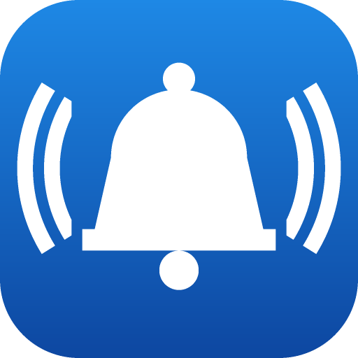
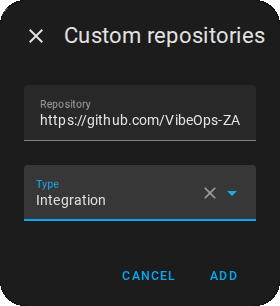
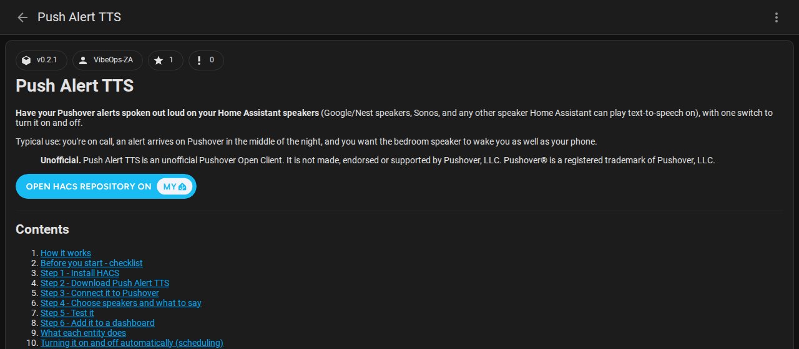
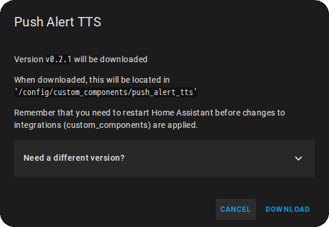
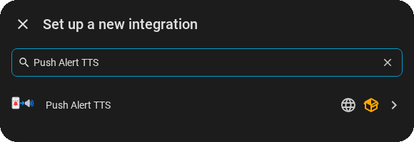
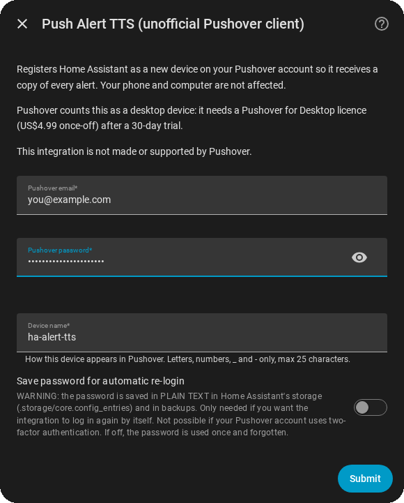
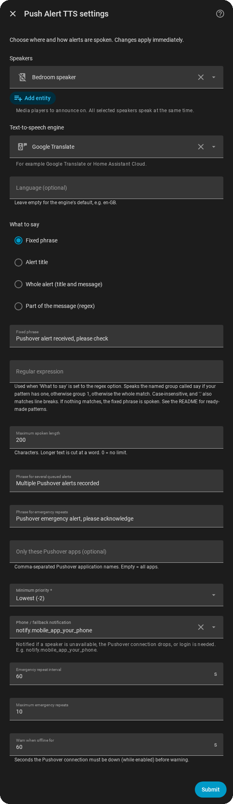
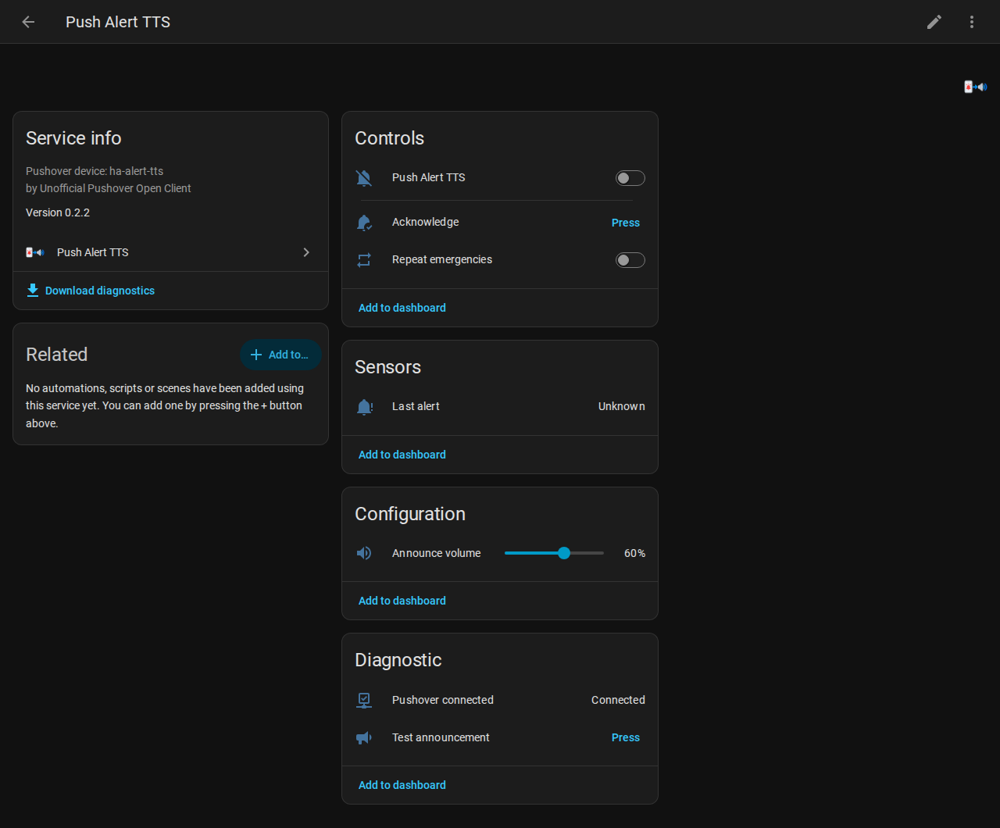
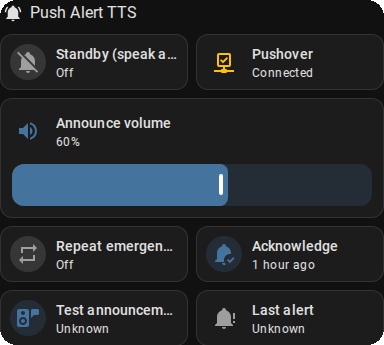
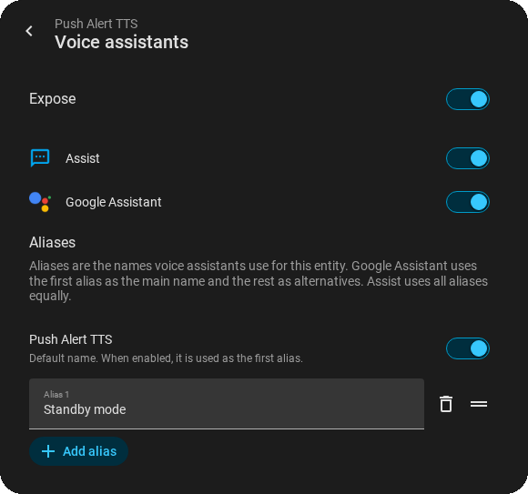

# Push Alert TTS



**Have your Pushover alerts spoken out loud on your Home Assistant speakers**
(Google/Nest speakers, Sonos, and any other speaker Home Assistant can play
text-to-speech on), with one switch to turn it on and off.

Typical use: you're on call, an alert arrives on Pushover in the middle of the
night, and you want the bedroom speaker to wake you as well as your phone.

> **Unofficial.** Push Alert TTS is an unofficial Pushover Open Client. It is
> not made, endorsed or supported by Pushover, LLC. Pushover® is a registered
> trademark of Pushover, LLC.

[](https://my.home-assistant.io/redirect/hacs_repository/?owner=VibeOps-ZA&repository=push-alert-tts&category=integration)

---

## Contents

1. [How it works](#1-how-it-works)
2. [Before you start - checklist](#2-before-you-start---checklist)
3. [Step 1 - Install HACS](#3-step-1---install-hacs)
4. [Step 2 - Download Push Alert TTS](#4-step-2---download-push-alert-tts)
5. [Step 3 - Connect it to Pushover](#5-step-3---connect-it-to-pushover)
6. [Step 4 - Choose speakers and what to say](#6-step-4---choose-speakers-and-what-to-say)
7. [Step 5 - Test it](#7-step-5---test-it)
8. [Step 6 - Add it to a dashboard](#8-step-6---add-it-to-a-dashboard)
9. [What each entity does](#9-what-each-entity-does)
10. [Turning it on and off automatically (scheduling)](#10-turning-it-on-and-off-automatically-scheduling)
11. [Voice control (Google / Alexa / Assist)](#11-voice-control-google--alexa--assist)
12. [Emergency alerts, repeats and Acknowledge](#12-emergency-alerts-repeats-and-acknowledge)
13. [Login, passwords and security](#13-login-passwords-and-security)
14. [Advanced: automations, events and actions](#14-advanced-automations-events-and-actions)
15. [Troubleshooting](#15-troubleshooting)
16. [Updating and removing](#16-updating-and-removing)
17. [FAQ](#17-faq)
18. [AI wording with a local LLM (optional)](#18-ai-wording-with-a-local-llm-optional)
19. [Combining alerts and must-hear speakers (optional)](#19-combining-alerts-and-must-hear-speakers-optional)
20. [A voice with a backup for your own automations](#20-a-voice-with-a-backup-for-your-own-automations)

---

## 1. How it works

- Home Assistant logs in to Pushover **once** and adds itself as an extra
  device on your Pushover account, just like adding a second phone.
- From then on, every Pushover alert you receive is also sent to Home
  Assistant. **Your phone and computer keep getting every alert exactly as
  before.** Nothing is taken away from them.
- When an alert arrives and the **Push Alert TTS** switch is on, Home
  Assistant turns your chosen speakers up to the announce volume, speaks the
  alert, and then puts the volume back to what it was.
- If Home Assistant was restarting or offline when alerts arrived, they are
  collected as soon as it reconnects. If several arrived, it says "Multiple
  Pushover alerts recorded".
- Home Assistant connects **out** to Pushover. You don't need to open any
  ports or expose Home Assistant to the internet.

---

## 2. Before you start - checklist

Work through this list. Each item links to the official guide if you need to
set it up.

| # | You need | How to check / set it up |
|---|---|---|
| 1 | **Home Assistant 2025.6 or newer** | Check under **Settings → About**. New to Home Assistant? Start at [Installation](https://www.home-assistant.io/installation/) and [Getting started](https://www.home-assistant.io/getting-started/). To update: [Updating Home Assistant](https://www.home-assistant.io/common-tasks/general/). |
| 2 | **An administrator login** to Home Assistant | Only admins can add integrations. See [Users](https://www.home-assistant.io/docs/authentication/). |
| 3 | **A speaker that Home Assistant can use** | Go to **Settings → Devices & services → Entities** and search for `media_player`. Google/Nest speakers usually appear automatically through [Google Cast](https://www.home-assistant.io/integrations/cast/). Sonos: [Sonos integration](https://www.home-assistant.io/integrations/sonos/). Others: search the [integrations list](https://www.home-assistant.io/integrations/). |
| 4 | **A text-to-speech (TTS) engine** | The free, easy option is [Google Translate text-to-speech](https://www.home-assistant.io/integrations/google_translate/). If you subscribe to [Home Assistant Cloud](https://www.nabucasa.com/), its [cloud voices](https://www.home-assistant.io/integrations/cloud/) work too. You can test it in **Settings → Developer tools → Actions**: choose *Text-to-speech (TTS): Speak*, pick your TTS engine and speaker, type "Hello", then **Perform action**. |
| 5 | **A Pushover account** with alerts already arriving on your phone | Sign up at [pushover.net](https://pushover.net/) and install the [iPhone/iPad](https://pushover.net/clients/ios) or [Android](https://pushover.net/clients/android) app. |
| 6 | **A Pushover for Desktop licence** | Pushover counts this integration as a *desktop* device. It's **free for 30 days**, then a **once-off US$4.99** per account, covering all your desktop devices. Buy it while logged in at [pushover.net/clients/desktop](https://pushover.net/clients/desktop). If you already use Pushover in a desktop web browser you may already own it. |
| 7 | **A free Pushover device slot** | Pushover allows 10 devices per account. Your devices are listed when you log in at [pushover.net](https://pushover.net/). |
| 8 | **HACS** (Home Assistant Community Store) | Used to download and update this integration. See [Step 1](#3-step-1---install-hacs). |
| 9 | *(Optional, recommended)* **The Home Assistant app on your phone** | Lets Push Alert TTS warn your phone if a speaker or the connection fails. Install from the [Companion app docs](https://companion.home-assistant.io/docs/getting_started/) and allow notifications. |
| 10 | *(Optional)* **Voice control** | For "Hey Google, turn on Push Alert TTS", see [section 11](#11-voice-control-google--alexa--assist). |

---

## 3. Step 1 - Install HACS

Skip this step if you already see **HACS** in your Home Assistant sidebar.

HACS is a free add-on store for community-made integrations like this one.
Follow the official guide, which has screenshots:

1. **Check the prerequisites:** [HACS prerequisites](https://hacs.xyz/docs/use/download/prerequisites/).
   You need a free [GitHub account](https://github.com/signup).
2. **Download HACS:** [Download HACS](https://hacs.xyz/docs/use/download/download/).
   - **Home Assistant OS** (most Raspberry Pi, Home Assistant Green/Yellow and
     virtual-machine installs): you add the HACS *app* and start it. The guide
     shows how.
   - **Container / Core installs:** you run a one-line script. The guide shows
     how.
3. **Restart Home Assistant:** **Settings → System →** power icon (top right)
   **→ Restart Home Assistant**.
4. **Set up HACS:** [Initial configuration](https://hacs.xyz/docs/use/configuration/basic/).
   In short: **Settings → Devices & services → + Add integration → HACS**,
   tick the boxes, then link it to GitHub using the code it shows you. Refresh
   your browser if HACS doesn't appear in the list.

When it's done, **HACS** appears in the left sidebar.

---

## 4. Step 2 - Download Push Alert TTS

### Option A - one click

Click this button. It opens your Home Assistant at the right place in HACS:

[](https://my.home-assistant.io/redirect/hacs_repository/?owner=VibeOps-ZA&repository=push-alert-tts&category=integration)

The first time, it asks for your Home Assistant address, e.g.
`http://homeassistant.local:8123`. Then click **Download**, keep the latest
version, and click **Download** again. Continue at step 4 below.

### Option B - by hand

1. Open **HACS** from the sidebar.
2. Click the **three dots (⋮)** in the top-right corner → **Custom repositories**.
3. In **Repository**, paste `https://github.com/VibeOps-ZA/push-alert-tts`.
4. In **Type** (or *Category*), choose **Integration**, then click **Add**.
   ([HACS guide to custom repositories](https://hacs.xyz/docs/faq/custom_repositories/))

   
5. Close the dialog. Search HACS for **Push Alert TTS** and open it.

   
6. Click **Download** (bottom right), keep the latest version, then click **Download**.

   
7. **Restart Home Assistant** (**Settings → System →** power icon **→ Restart
   Home Assistant**). Home Assistant usually also shows a *Restart required*
   repair message you can click.

### Option C - without HACS (manual)

1. Download the latest release ZIP from the [Releases page](https://github.com/VibeOps-ZA/push-alert-tts/releases),
   or the code via **Code → Download ZIP**.
2. Copy the folder `custom_components/push_alert_tts` into your Home Assistant
   `config/custom_components/` folder. Create `custom_components` if it
   doesn't exist. To reach the config folder, use the
   File editor or Samba share app
   ([how to access your config files](https://www.home-assistant.io/common-tasks/os/#configuring-access-to-files)).
3. Restart Home Assistant.

You won't get automatic update notices with the manual method.

---

## 5. Step 3 - Connect it to Pushover

[](https://my.home-assistant.io/redirect/config_flow_start/?domain=push_alert_tts)

Or by hand: **Settings → Devices & services → + Add integration** (bottom
right) → search **Push Alert TTS**. If it isn't listed, refresh the browser
page. If it's still missing, Home Assistant hasn't been restarted since the
download.

<p></p>

Fill in:

| Field | What to enter |
|---|---|
| **Pushover email** | The email you log in to pushover.net with. |
| **Pushover password** | Your Pushover password. It is used to log in once. Unless you tick the box below, it is then thrown away. |
| **Device name** | How Home Assistant will appear in your Pushover device list. Default `ha-alert-tts`. Letters, numbers, `_` and `-` only, up to 25 characters. Must be different from your other Pushover device names. |
| **Save password for automatic re-login** | Leave **off** unless you understand [section 13](#13-login-passwords-and-security). If on, the password is stored **in plain text** so the integration can log in again by itself. |

<p></p>

Click **Submit**.

- If your Pushover account uses **two-factor authentication**, you'll be asked
  for the 6-digit code from your authenticator app.
- You'll see **Success**. Pushover may notify you that a new device was added.
- A device called **Push Alert TTS** now appears under
  **Settings → Devices & services → Push Alert TTS**.

Nothing will be spoken yet. Next you choose the speakers.

---

## 6. Step 4 - Choose speakers and what to say

Go to **Settings → Devices & services → Push Alert TTS → ⚙ Configure** (the
cog, or **⋮ → Configure** on some versions). Every setting can be changed at
any time and takes effect immediately; nothing restarts.

<details>
<summary>Screenshot of the settings form</summary>

<p></p>
</details>

The examples below use this sample alert:

> **Title:** `PROD: disk full`
> **Message:**
> ```
> Host web-01 /var at 98%
> Runbook: https://wiki.example.com/disk
> Triggered by Datadog monitor 1234
> ```
> **App:** `Datadog`  **Priority:** High (1)

### Speakers *(required)*

The speakers to announce on. Pick one or more. They are all asked to speak at
the same time, but separate speakers each download and buffer the audio on
their own, so they can start a second or so apart and sound like an echo. To
keep them in step, also set a **Speaker group** (next option).
Nothing is spoken until at least one speaker is chosen.

### Speaker group (plays in sync) *(optional)*

A speaker group makes all its speakers play **at exactly the same time**.
Leave this empty to keep the normal behaviour (each speaker on its own).

1. Create the group first. For Google / Nest speakers use the Google Home app
   on your phone: **+ (Add) → Speaker group**, tick the speakers, name it and
   save ([Google's guide](https://support.google.com/googlehome/answer/7174267)).
   Home Assistant's [Google Cast](https://www.home-assistant.io/integrations/cast/)
   integration finds the new group by itself within a minute or so; it shows up
   as a `media_player` entity with the group's name (check under
   **Settings → Devices & services → Entities**).
2. In **Speakers**, pick the *individual* speakers that are in the group.
   They are still used to set the announce volume (and put each speaker's own
   volume back afterwards), and as the fallback below.
3. In **Speaker group**, pick the group. Don't also add it to *Speakers* (the
   form will tell you).

How it works and its safety net:
- The announcement plays on the group, so every speaker starts together.
- If the group is **unavailable** (for example a speaker in it is offline;
  Cast groups can disappear from Home Assistant then), each speaker in
  *Speakers* is used instead, as without a group.
- If the group **fails to play** or **doesn't start playing within 10
  seconds**, the next try (see *Retries*) uses each speaker, and the one after
  that the group again. With *Retries* at 0, each speaker is still tried once.
  Emergency alerts work the same way. In the rare case the group starts very
  late you may hear the alert twice; it is never skipped.
- If you pick only a group and leave *Speakers* empty, the group is used like
  a normal speaker (volume is set on the group, no fallback).
- The history and **Last alert** *timings* show which way was used
  (`route`, see [What is recorded](#what-is-recorded)).

### Wait for speakers to wake up *(default 10 seconds)*

Speakers that were switched off (Google speakers report *off* when idle for
a while) take a few seconds to come back. If the announcement starts before
that, the first words can be lost. Before speaking, Push Alert TTS waits up
to this many seconds until every speaker in *Speakers* is on. When the time
is up it speaks anyway, because playing the announcement wakes them too, so
this can only delay an alert by this long, never stop it.
Set **0** to not wait (the behaviour before version 0.9.0).

Whatever this is set to, Push Alert TTS starts waking the speakers as soon as
an alert arrives, while the alert is still being worded (since version
0.10.0), so they are usually awake by the time it speaks. Speakers that were
off are switched off again afterwards.

The *Speaker group* is not waited for: a Google Cast speaker group only comes
on once something is played on it, so waiting for it would only add delay
(version 0.9.0 did that, adding the full wait time when the speakers had been
off).

### Connect the speaker group early *(default off)*

Only used with a *Speaker group*. Connecting to a Google Cast speaker group
takes about 3 seconds. With this on, Push Alert TTS connects the group as soon
as an alert arrives, while the alert is still being worded (by the AI, if you
use it), so the announcement starts about 3 seconds sooner.

Some speakers (for example Google Nest speakers) play a short connect sound
when the group is connected, so the sound comes a few seconds before the
announcement. That's why it is off by default. Turn it on if you don't mind
the sound, or your speakers don't make one.

### Retries if an announcement fails or is cut short *(default 1, up to 5)*

The spoken audio is always made first, and only then are the speakers told to
play it (see [How an announcement is made](#how-an-announcement-is-made)).
After playing, Push Alert TTS watches the speaker (or group) and plays the
alert again, up to this many extra times, if:
- the speaker **wouldn't play** it (an error, or no answer within 20 seconds),
- the speaker **never started playing**, or
- it **stopped far sooner than the text needs** (cut short), for example
  because a speaker dropped out.

Each try plays once on one route (the group, or each speaker), so each try
makes at most one wake-up sound. When the group fails or doesn't start, the
next try uses each speaker (and the one after that the group again); a try
that was cut short repeats the same route. Retries use the *Backup
text-to-speech engine*'s audio if one is set.

A speaker briefly showing *buffering* in the middle of an announcement is
normal and isn't treated as the end. If every try fails, the **Phone / fallback
notification** ([below](#phone--fallback-notification-optional-recommended)) is sent with the text and what went wrong, so the alert
still reaches you. Tries are recorded as `attempts`, `retry_reason` and
`outcome` in the *timings* ([What is recorded](#what-is-recorded)).

Set **0** to turn retries off (the behaviour before version 0.9.0). Do that if
your speaker never reports *playing* to Home Assistant (check its state on
**Settings → Developer tools → States** while it speaks): it would otherwise
hear every alert twice.

### Text-to-speech engine *(required)*

The voice to use, e.g. `tts.google_en_com` or *Home Assistant
Cloud*. See checklist item 4 if the list is empty.

### Backup text-to-speech engine *(optional, recommended)*

A second voice, used when the main voice can't make the audio after all its
tries (see *Main voice: time per try* and *Main voice: extra tries* below), and
for playback retries. So a slow or broken voice service can't stop the alert.
The main voice is always preferred while it still has tries left; the backup
starts making its audio as soon as the main voice fails a try or is slow, so
it is ready the moment it is needed.

Pick a voice that works **without the internet** if you can: most voices,
including Google Translate, need the internet, and when your connection or
DNS is struggling they hang. A voice that runs on your own Home Assistant
keeps working then. The usual choice is
[Piper](https://www.home-assistant.io/integrations/piper/): install the
**Piper** app (add-on) from **Settings → Apps → App store**, start it, then
add the [Wyoming Protocol](https://www.home-assistant.io/integrations/wyoming/)
integration it offers under **Settings → Devices & services** (this creates
`tts.piper`). Choose the voice in *Backup voice name* below (or in the Piper
app's settings).

Piper voices come in quality levels: **low** (16 kHz audio, a little
muffled, like a phone call), **medium** and **high** (22 kHz, crisper "s" and
"t" sounds; high is a bigger model with slightly more natural rhythm).
Bigger is slower. Measured on a Raspberry Pi 4 for one alert sentence:
`en_GB-cori-medium` about 8-9 seconds, `en_GB-cori-high` about 35-60 seconds.
Because the backup audio is made in full before anything plays, a slow voice
only delays the alert, it doesn't cut it off; set *Backup voice: wait at most*
high enough for the voice you choose.

If you can't run a local voice, pick one from a **different** service from the
main one: two Google Translate voices (`tts.google_en_com` and
`tts.google_en_co_za`) use the same service and fail together. Other choices
are [Home Assistant Cloud](https://www.home-assistant.io/integrations/cloud/)
or [OpenAI](https://www.home-assistant.io/integrations/openai_conversation/).

Leave empty to use only the main voice. The *Language* setting below applies
to the main voice only; the backup uses its own default language.

### Backup voice name *(optional)*

The backup engine's own voice, if it has several. For Piper, the voice's name,
for example `en_GB-cori-high` or `en_GB-cori-medium`; the Piper app downloads
a voice the first time it is used. You can see the names under
**Settings → Voice assistants** (edit an assistant and open the voice list) or
in the [Piper voice samples](https://rhasspy.github.io/piper-samples/). Empty =
the engine's default voice.

### Main voice: time per try *(default 20 seconds)* and extra tries *(default 3)*

How long the main voice may take to make the audio, and how many more times it
is tried if it fails or is too slow (for example on a poor internet
connection), before the backup voice is used. Be generous: a short delay is
much better than a missed alert.

### Backup voice: wait at most *(default 120 seconds)*

How long the backup voice may take to make the audio. Local voices on a small
computer can be slow (see above). If the backup voice can't make it either,
the recorded fixed phrase is played and the text goes to your phone.

### How an announcement is made

1. **The audio is made first.** The main voice makes the spoken audio, with
   its extra tries; the backup voice is made alongside if the main one fails
   a try or is slow, and used only if the main voice gives up (see above). Nothing is sent
   to the speakers yet, so a slow or unreachable voice service can't leave a
   speaker waiting, timing out, or making wake-up sounds for nothing.
2. **If no voice can make it**, the *Fixed phrase* recorded in advance is
   used (see below), and the alert's full text is sent to the *Phone /
   fallback notification*.
3. **The speakers play the ready audio**, with the retries above if needed.
4. **If it still can't be played**, the *Phone / fallback notification* is sent
   with the text and the reason.

**The recorded fixed phrase.** Push Alert TTS records the *Fixed phrase*
(main voice, else the backup) and keeps the recording in
`/config/push_alert_tts/`. It is recorded when Home Assistant starts and again
when the phrase or the voices change (checked every hour, so a failed
recording is tried again). A recording that fails keeps the old one. It plays
even when no voice service works, for example during an internet outage, so
you at least hear that an alert came in.

### Language *(optional)*

Leave empty to use the engine's default. Otherwise enter a language code the
engine supports, e.g. `en-GB`, `en-US`, `en-AU`, `de`.
Each engine's documentation lists its codes, e.g.
[Google Translate](https://www.home-assistant.io/integrations/google_translate/)
or [Home Assistant Cloud](https://www.home-assistant.io/integrations/cloud/).

### What to say

| Choice | What is spoken for the sample alert | Good for |
|---|---|---|
| **Fixed phrase** *(default)* | "Pushover alert received, please check" | Waking you up without reading anything sensitive aloud. |
| **Alert title** | "PROD: disk full" | Short, informative alerts. |
| **Whole alert** | "PROD: disk full. Host web-01 /var at 98% Runbook: link Triggered by Datadog monitor 1234" (cut to the maximum length) | Short alerts where you want everything. |
| **Part of the message (regex)** | Whatever your pattern picks out, e.g. "Host web-01 /var at 98%", or a short sentence built from several parts with a *spoken template* | Long alerts where only one or two parts matter. See below. |

In every mode:
- Web links are spoken as "link", and HTML formatting is removed.
- If the title or regex produces nothing, the **fixed phrase** is spoken, so an
  alert is never silently skipped.
- If several alerts arrive at once (e.g. after an outage), the
  **phrase for several queued alerts** is spoken instead.

### Fixed phrase

The sentence used by *Fixed phrase* mode, and the fallback for the other modes.
It is also recorded in advance and played when no voice can make the audio
(see [How an announcement is made](#how-an-announcement-is-made)).
Default: `Pushover alert received, please check`.

### Regular expression (only for "Part of the message")

A [regular expression](https://docs.python.org/3/howto/regex.html) ("regex")
is a search pattern. Push Alert TTS searches the alert (by default the
**message** first, then the **title**; see *Where the regex looks* below).

**Without a spoken template** it speaks:
1. the part in a group named `say`, written `(?P<say> ... )`, if your pattern
   has one, otherwise
2. the part in the first set of brackets `( ... )`, otherwise
3. everything the pattern matched.

**With a spoken template** (below) you can pick out several parts and arrange
them into a sentence.

Matching ignores upper/lower case, `^` and `$` match the start and end of each
line, and `.` also matches line breaks.

Ready-made patterns to copy:

| I want to hear… | Pattern | Result for the sample |
|---|---|---|
| Only the first line of the message | `^(?P<say>[^\n]+)` | "Host web-01 /var at 98%" |
| The word after "Host" | `Host:?\s*(?P<say>\S+)` | "web-01" |
| Everything before the first full stop | `^(?P<say>[^.]+)` | "Host web-01 /var at 98%" (up to the first `.`) |
| A line starting "Summary:" | `^Summary:\s*(?P<say>.+?)$` | *(no match → fixed phrase)* |
| Severity and the next word | `(?P<say>(?:CRITICAL\|WARNING\|ERROR)\s+\S+)` | *(no match → fixed phrase)* |
| A percentage | `(?P<say>\d+%)` | "98%" |

To build and test your own, paste a real alert into [regex101.com](https://regex101.com/),
choose the **Python** flavour on the left, and turn on the `i`, `m` and `s`
flags to match how Push Alert TTS searches. An invalid pattern is rejected
when you click Submit. Then use the
[`push_alert_tts.preview`](#actions) action to see exactly what would be
spoken, using your real last alert.

### Where the regex looks

Which part of the alert the regex searches, in this order; the first match
wins:

| Choice | Searches |
|---|---|
| **Message, then title** *(default)* | the message; if nothing matches, the title |
| **Title, then message** | the title; if nothing matches, the message |
| **Title only** | only the title (best when the title is a one-line summary) |
| **Message only** | only the message |

Only the first 500 characters of the title and 4,000 of the message are ever
searched, so a huge alert can't slow things down.

### Spoken template *(optional, regex mode only)*

Builds the spoken sentence from **named groups** in your regex. A named group
is written `(?P<name> ... )`; in the template you write the name in curly
brackets: `{name}`. Everything else in the template is spoken as written.

Example, for alerts whose **title** looks like
`[P1] Triggered: http | web_service_check | app01.prod [env:prod]`:

- **Regular expression:**
  ```
  ^\s*\[P\d\]\s*(?P<state>[A-Za-z][A-Za-z -]{0,19}):\s*(?P<s1>[^|\[]{1,60})(?:\|\s*(?P<s2>[^|\[]{1,60}))?(?:\|\s*(?P<s3>[^|\[]{1,60}))?
  ```
- **Where the regex looks:** Title only
- **Spoken template:** `Alert, {s1}, {s2}, {s3}, {state}`
- **Spoken:** "Alert, http, web service check, app01 prod, Triggered"

How the pattern works: `\[P\d\]` skips `[P1]`; `(?P<state>…)` takes the word(s)
before the colon; `s1`, `s2` and `s3` each take one `|`-separated part and stop
at `|` or `[`; the `(?: … )?` around `s2` and `s3` makes them optional.

Another example, for a plain message such as
`CRITICAL: db01 disk /var at 97%`:

- **Regular expression:** `(?P<level>CRITICAL|WARNING)\W+(?P<host>\S+)\D*(?P<pct>\d+%)`
- **Spoken template:** `{level} on {host}, {pct}`
- **Spoken:** "CRITICAL on db01, 97%"

You can also use, without adding them to your regex:

| Placeholder | Is replaced by |
|---|---|
| `{app}` | The Pushover application name, e.g. Datadog |
| `{priority}` | The priority number, -2 to 2 |
| `{priority_name}` | lowest, low, normal, high or emergency |
| `{title}`, `{message}` | The whole title or message (cut to the part length below) |
| `{1}`, `{2}`, … | Unnamed groups, by number |

Write `{{` or `}}` to speak a literal curly bracket. A named group with the
same name as a built-in (e.g. `app`) wins.

When you click Submit, a template that uses a name your regex doesn't capture
(e.g. a typo like `{hots}`) is rejected, so mistakes show up straight away.

**Safety nets.** A template can never ramble on:
1. Each placeholder is cut (at a word) to the **maximum length of each
   template part**.
2. Empty placeholders are left out together with their commas, so a missing
   part never sounds like "Alert, , , Triggered". With **Remove repeated
   words** on, words an earlier placeholder already said are left out too.
3. If **fewer than half** of the placeholders are filled (or none are), the
   alert probably isn't in the format you expected, so the **fixed phrase** is
   spoken instead. If the regex doesn't match at all, the fixed phrase is also
   spoken.
4. The whole sentence is cut to the **maximum spoken length** (and never more
   than 2,000 characters).
5. A regex is given 2 seconds; a pattern that takes longer (for example one
   that backtracks badly on an unusual alert) is abandoned, the fixed phrase is
   spoken and a warning is written to the Home Assistant log.

### Maximum length of each template part

The most characters any one placeholder can add. Longer values are cut at a
word. Default `40`. `0` = no limit (the maximum spoken length still applies).

### Tidy text for speech

On by default. Makes machine-style text sound natural before it is spoken
(in every mode except *Fixed phrase*):

| Text | Spoken as |
|---|---|
| `web_service_check` | "web service check" |
| `app01.prod.example` | "app01 prod example" (numbers such as `2.5` are left alone) |
| `a \| b` | "a, b" (a short pause) |
| `a , , b,` | "a, b" |

Turn it off if you want the text exactly as received.

### Expand common abbreviations

Off by default. Speaks common IT shorthand in full, so `shop.lb01.prod`
becomes "shop load balancer 01 production". It only replaces whole words
(a number straight after is fine, e.g. `db01`), works in every mode except
*Fixed phrase*, and ignores upper/lower case. The list:

`avg` average, `cnt` count, `conn` connection, `conns` connections, `db` database, `dbs` databases, `dev` development, `env` environment, `err` error, `errs` errors, `k8s` Kubernetes, `lb` load balancer, `mem` memory, `mgmt` management, `msg` message, `msgs` messages, `prod` production, `qty` quantity, `req` request, `reqs` requests, `resp` response, `srv` server, `stg` staging, `svc` service, `svcs` services, `txn` transaction, `txns` transactions.

The list is deliberately short: words that are already easy to say (`app`,
`cpu`) or that have two common meanings (`sec`, `auth`, `ms`) are left alone.
Expanded words are longer, so you may want to raise the **maximum length of
each template part** when you turn this on.

### Remove repeated words (template)

On by default; only affects the spoken template. A word that an earlier part
of the sentence already said is left out, so a name repeated in the alert is
spoken once. For the title
`[P1] Re-Triggered: eu_shop_pay_hr | threshold | integration pay shop`:

| Setting | Spoken |
|---|---|
| On | "Alert, eu shop pay hr, threshold, integration, Re-Triggered" |
| Off | "Alert, eu shop pay hr, threshold, integration pay shop, Re-Triggered" |

### Word replacements for the normal text (optional)

Swap words or phrases in the normal (non-AI) spoken text. One per line,
written as `from = to`, for example:

```
Re-Triggered = re alert
prod = production
```

Matches whole words or phrases only (so `prod` does not change `product`)
and ignores capitals. It runs after tidying and abbreviations, on the final
sentence. Empty (the default) = off. It does **not** change the AI's wording:
for that, use the AI instructions or the AI memory
([section 18](#18-ai-wording-with-a-local-llm-optional)).

A part that ends up empty because all its words were already said is simply
left out; it still counts as *filled* for the "fewer than half" safety net.

### Maximum spoken length

The most characters that will be spoken. Longer text is cut at a word
boundary. Default `200` (roughly 15 seconds of speech). `0` = no limit
(a hard limit of 2,000 characters always applies).

### Phrase for several queued alerts

Spoken when more than one alert arrives at the same moment, usually after Home
Assistant was restarting or offline. Default: `Multiple Pushover alerts recorded`.

### Phrase for emergency repeats

Spoken on each repeat of an unacknowledged emergency alert (see
[section 12](#12-emergency-alerts-repeats-and-acknowledge)). Default:
`Pushover emergency alert, please acknowledge`.

### Only these Pushover apps *(optional)*

Leave empty to announce alerts from **every** app. To limit it, list Pushover
application names separated by commas, e.g. `Datadog, Grafana`. Case doesn't
matter. The app name is shown with each alert in the Pushover phone app, and
under *Last alert → app* in Home Assistant after the first alert.

### Minimum priority

Alerts below this [Pushover priority](https://pushover.net/api#priority) are
not announced (they're still received and logged):

| Priority | Meaning in Pushover |
|---|---|
| Lowest (-2) | No notification at all on your phone |
| Low (-1) | Quiet notification, no sound |
| Normal (0) | Normal notification |
| High (1) | Bypasses your phone's Pushover quiet hours |
| Emergency (2) | Repeats on your phone until acknowledged |

Default: **Lowest (-2)**, meaning everything is announced.

### Phone / fallback notification *(optional, recommended)*

A notification action Push Alert TTS uses to warn you when something is wrong:
- a chosen speaker is unavailable when an alert arrives,
- the Pushover connection is down while the switch is on,
- Pushover needs you to log in again.

Pick your phone from the list, e.g. `notify.mobile_app_your_phone`. That
appears once the [Home Assistant Companion app](https://companion.home-assistant.io/docs/getting_started/)
is installed and logged in on your phone. On iPhone these warnings are sent as
*Time Sensitive*, so they can break through Focus modes if you allow it in iOS
settings. Any other `notify.*` action (e.g. email, Telegram) can be typed in too.

### Emergency repeat interval / Maximum emergency repeats

How often (in seconds) and how many times an unacknowledged emergency alert is
repeated on the speakers when **Repeat emergencies** is on. Defaults: `60`
seconds, `10` times.

### Warn when offline for

How long (in seconds) the Pushover connection must be down, while the switch is
on, before you're warned. Default `60`. Short drops are normal and reconnect
automatically; alerts sent meanwhile are collected after reconnecting.

How the connection is kept healthy (since version 0.10.0, nothing to set):
- Pushover sends a small keep-alive signal every so often. Push Alert TTS
  measures how often, and treats the connection as dead after 2.5 times the
  longest recent gap (at least 45 and at most 120 seconds), then reconnects
  after 5 seconds. When Pushover itself closes the connection it waits 15
  seconds first, as Pushover asks.
- While disconnected, it also checks Pushover for new alerts every 30
  seconds, so alerts still arrive if only the live connection has trouble.
- Each drop is logged as a warning and counted on the **Pushover connected**
  sensor (see [section 9](#9-what-each-entity-does)).

### Keep alert history for

How many days of received alerts to keep, `0`-`90`. Default `0` (off).
When on, every alert received (spoken or not) is added to a small file,
`push_alert_tts/history_<entry id>.jsonl` in your Home Assistant
[configuration folder](https://www.home-assistant.io/docs/configuration/).
Each line holds the time, app, priority, title, message (up to 4,000
characters) and its original length, the alert's link (if any), whether it was
announced and what was spoken. With [AI wording](#18-ai-wording-with-a-local-llm-optional)
on it also holds the normal text, the AI's answer, which of the two was spoken
and why, and how long each step took (see [section 18](#what-is-recorded)). Older lines are
removed once a day, and there is a cap of 20,000 alerts whatever the period.
As a guide, 1,000 alerts take about 1 MB.

Read it with the [`push_alert_tts.get_history`](#actions) action. Setting the
period back to `0` stops recording and **deletes** the saved history. The
file is included in Home Assistant backups, and is deleted if you delete the
integration.

### Combining and delivery *(optional)*

A collapsible section of the options. Everything in it is off until
*Combine alerts* is switched on. See
[Combining alerts and must-hear speakers](#19-combining-alerts-and-must-hear-speakers-optional)
for what each setting does.

### AI wording *(optional)*

A collapsible **AI wording** section at the bottom of the settings lets a
language model that you run yourself (for example
[Ollama](https://ollama.com/) on a PC) word each alert as one short sentence.
It is off by default and nothing changes until you turn it on. Everything
about it, including setup, is in
[section 18](#18-ai-wording-with-a-local-llm-optional).

---

## 7. Step 5 - Test it

1. Open **Settings → Devices & services → Push Alert TTS →** the **Push
   Alert TTS** device.
2. Turn on the **Push Alert TTS** switch.
3. Press **Test announcement** (under *Diagnostic*). Your speakers should say
   the fixed phrase.
4. Now test the whole path: log in at [pushover.net](https://pushover.net/),
   use the **send a notification** box on the main page, leave the device as
   **(all devices)**, type a message, and send. Within a few seconds your
   phone gets it and your speakers announce it. **Last alert** updates.

<p></p>

---

## 8. Step 6 - Add it to a dashboard

Using the visual editor:
1. Open a dashboard and click the **pencil** (top right) to edit. New to
   dashboards? See [Dashboards](https://www.home-assistant.io/dashboards/).
2. **+ Add card** → **By entity** → search `push alert tts` → tick the
   entities you want → **Continue** → **Add to dashboard**.

Example card (tile cards in a dashboard section):

<p></p>

Or paste this card. Click **+ Add card → Manual** and replace the text:

```yaml
type: entities
title: Push Alert TTS
entities:
  - entity: switch.push_alert_tts
    name: Announce alerts
  - entity: number.push_alert_tts_announce_volume
  - entity: switch.push_alert_tts_repeat_emergencies
  - entity: button.push_alert_tts_acknowledge
  - entity: binary_sensor.push_alert_tts_pushover_connected
  - entity: sensor.push_alert_tts_last_alert
```

If you renamed anything, use the names shown on the device page instead.

---

## 9. What each entity does

| Entity (default ID) | What it does |
|---|---|
| **Push Alert TTS** `switch.push_alert_tts` | Main on/off. **Off** = alerts are still received and logged, just not spoken. Remembers its state across restarts. |
| **Announce volume** `number.push_alert_tts_announce_volume` | Volume used while speaking (0-100 %, default 60 %). The previous volume is put back afterwards. |
| **Repeat emergencies** `switch.push_alert_tts_repeat_emergencies` | Repeat *emergency-priority* alerts until acknowledged. |
| **Acknowledge** `button.push_alert_tts_acknowledge` | Acknowledge pending emergency alerts and stop repeats ([section 12](#12-emergency-alerts-repeats-and-acknowledge)). |
| **Test announcement** `button.push_alert_tts_test_announcement` | Speak the fixed phrase now. |
| **Pushover connected** `binary_sensor.push_alert_tts_pushover_connected` | Connected / Disconnected. Its *status* attribute is `connected`, `reconnecting`, `login_required` or `stopped`, and *last_error* says why. Since 0.10.0 also: *drops* (times a working connection dropped since Home Assistant started), *last_drop* / *last_drop_reason*, *polled_alerts* / *last_poll* (alerts collected while disconnected), *keepalive_interval_s* (longest recent gap between Pushover's keep-alives) and *dead_after_s* (silence after which it reconnects). |
| **Last alert** `sensor.push_alert_tts_last_alert` | When the last alert arrived. Attributes: title, message, app, priority, count, queued, announced, spoken_text, pending_emergencies, and (since 0.5.0) spoken_source (`ai` or `filter`), filter_text, ai_text, ai_reason, ai_seconds and timings. |
| **AI review** `sensor.push_alert_tts_ai_review` | How many alerts the AI looked at in the last 3 days. Its *alerts* attribute lists them, newest first: the alert as received, what was spoken, the AI's text and the reason if it wasn't used. Not saved in the recorder database. See [section 18](#18-ai-wording-with-a-local-llm-optional). |
| **AI reachable** `binary_sensor.push_alert_tts_ai_reachable` | Connected / Disconnected: whether the main LLM server answers (unknown until first checked; unavailable while AI wording is off). Attributes: *unreachable_since*, *last_answer_from* (`main` or `backup`), *backup_set*, *backup_allowed_now*. |
| **Re-word missed alerts** `button.push_alert_tts_re_word_missed_alerts` | Asks the AI to word the last 3 days' alerts that got no AI text, for the AI review list. Nothing is spoken. Same as the `push_alert_tts.reprocess_ai` action. |
| **Voice with backup** `tts.push_alert_tts_voice_with_backup` | A text-to-speech voice for your own automations: your main voice with its tries, else the backup voice ([section 20](#20-a-voice-with-a-backup-for-your-own-automations)). |
| **AI correction** `text.push_alert_tts_ai_correction` | Type a correction for the AI in plain words and press Enter: it is added to the AI memory and the box clears. Its *memory* attribute shows the whole memory. |

About speakers:
- A speaker already at the announce volume is left alone (Google speakers beep
  at every volume change); only volumes that were changed are put back.
- A **muted** speaker is unmuted for the announcement and muted again afterwards.
- A speaker that was **off** is turned off again afterwards.
- If a speaker can't report its current volume (rare), it is still set to the
  announce volume so you hear the alert, but its old volume can't be restored.

---

## 10. Turning it on and off automatically (scheduling)

The main switch is an ordinary Home Assistant switch, so you can control it the
same way as any light or plug. Pick one method.

### Method 1 - a weekly schedule (no code)

1. **Settings → Devices & services → Helpers → + Create helper → Schedule**.
   Name it e.g. `Standby hours` and drag on the calendar to mark when you're on
   call. ([Schedule helper docs](https://www.home-assistant.io/integrations/schedule/))
2. **Settings → Automations & scenes → + Create automation → Create new automation**.
3. **⋮ → Edit in YAML**, replace everything with the YAML below, and **Save**.

```yaml
alias: Push Alert TTS follows standby schedule
triggers:
  - trigger: state
    entity_id: schedule.standby_hours
    to: ["on", "off"]
actions:
  - action: "switch.turn_{{ trigger.to_state.state }}"
    target:
      entity_id: switch.push_alert_tts
mode: single
```

### Method 2 - fixed times every day

```yaml
alias: Push Alert TTS overnight
triggers:
  - trigger: time
    at: "22:00:00"
    id: "on"
  - trigger: time
    at: "06:30:00"
    id: "off"
actions:
  - action: "switch.turn_{{ trigger.id }}"
    target:
      entity_id: switch.push_alert_tts
mode: single
```

### Method 3 - an on-call calendar

If your rota is in a calendar connected to Home Assistant (e.g.
[Google Calendar](https://www.home-assistant.io/integrations/google/) or
[Local Calendar](https://www.home-assistant.io/integrations/local_calendar/)):

```yaml
alias: Push Alert TTS follows on-call calendar
triggers:
  - trigger: calendar
    event: start
    entity_id: calendar.on_call
    id: "on"
  - trigger: calendar
    event: end
    entity_id: calendar.on_call
    id: "off"
actions:
  - action: "switch.turn_{{ trigger.id }}"
    target:
      entity_id: switch.push_alert_tts
mode: single
```

New to automations? See [Automation basics](https://www.home-assistant.io/docs/automation/basics/)
and [Editing automations in YAML](https://www.home-assistant.io/docs/automation/editor/).

---

## 11. Voice control (Google / Alexa / Assist)

1. Make your voice assistant available to Home Assistant first:
   - **Google Assistant / Alexa** via
     [Home Assistant Cloud](https://www.nabucasa.com/) (easiest; see the
     [Home Assistant Cloud docs](https://www.home-assistant.io/integrations/cloud/)), or the
     free manual [Google Assistant](https://www.home-assistant.io/integrations/google_assistant/)
     setup.
   - **Assist** (Home Assistant's own voice): see [Assist](https://www.home-assistant.io/voice_control/).
2. Expose the entities: **Settings → Voice assistants → Expose → + Expose
   entities**, choose the assistant, tick **Push Alert TTS** and
   **Acknowledge**. ([Exposing entities](https://www.home-assistant.io/voice_control/voice_remote_expose_devices/))
3. Say:
   - "Hey Google, turn **on** / **off** Push Alert TTS"
   - "Hey Google, activate Acknowledge". Google treats buttons as scenes, so
     "activate" is required.

Want a different phrase? Give the entity a different name or an
[alias](https://www.home-assistant.io/voice_control/aliases/) in Home Assistant:
open the entity → **⚙ Settings → Voice assistants**. In this example the switch
also answers to "Standby mode" ("Hey Google, turn on standby mode").

<p></p>

---

## 12. Emergency alerts, repeats and Acknowledge

Pushover's **emergency (priority 2)** alerts repeat on your phone until someone
acknowledges them.

- **Repeat emergencies** on: the speakers repeat the *emergency phrase* every
  *repeat interval* until the alert is acknowledged, the switch is turned off,
  or the *maximum repeats* is reached.
- **Acknowledge** button: tells Pushover the alert is acknowledged. Pushover
  then stops re-alerting on **every** device on your account (phone, computer
  and Home Assistant), and the speakers stop repeating.
- Acknowledged on your **phone** instead? Home Assistant sees that and stops
  repeating too.
- Pending emergencies are remembered across Home Assistant restarts, so
  Acknowledge still works afterwards.

Normal and high-priority alerts don't need acknowledging, and Pushover gives
third-party clients no way to clear them from your other devices.

---

## 13. Login, passwords and security

- **Default (recommended):** your password is used once at setup to get a
  Pushover session, then discarded. Pushover sessions don't normally expire.
- **If Pushover ever rejects the session:**
  - Home Assistant shows a **Re-authenticate** prompt under
    **Settings → Devices & services**, plus a notification.
  - If you set a phone/fallback notification, you also get a message there.
  - Click **Re-authenticate** and log in again. The same Pushover device is
    kept where possible.
- **Save password for automatic re-login:**
  - Lets the integration log in again by itself, without your help.
  - The password is stored **in plain text** in Home Assistant's
    `.storage/core.config_entries` file, and therefore in your
    [backups](https://www.home-assistant.io/common-tasks/general/).
    A password can't be hashed and still be used to log in.
  - It does **not** work with two-factor authentication, because a new code is
    needed each time.
  - To change this choice later, go to **Settings → Devices & services → Push
    Alert TTS → ⋮ → Reconfigure**, log in again, and tick or untick the box.
- **When logging in again doesn't help,** the cause is usually an expired
  Desktop licence, the device being deleted on pushover.net, or the device
  being logged in elsewhere. Push Alert TTS raises an item in
  [Repairs](https://www.home-assistant.io/integrations/repairs/)
  (**Settings → System → Repairs**) explaining why, and keeps retrying quietly
  in case it was temporary.
- **Diagnostics** downloads (device page → **⋮ → Download diagnostics**) hide
  your email, password, session and device ID.

---

## 14. Advanced: automations, events and actions

### Event: `push_alert_tts_alert`

Fired for **every** alert, whether or not it was spoken. Use it to do more than
speak, e.g. flash lights:

```yaml
alias: Flash bedroom light on high-priority Pushover alerts
triggers:
  - trigger: event
    event_type: push_alert_tts_alert
conditions:
  - condition: template
    value_template: "{{ trigger.event.data.highest_priority >= 1 }}"
actions:
  - action: light.turn_on
    target:
      entity_id: light.bedroom
    data:
      flash: long
```

The event data includes `count`, `queued`, `highest_priority`, `emergency`,
`title`, `message`, `app`, `announced`, `spoken_text`, `link` (see *Link
label*) and `messages` (the raw Pushover fields). With *Combine alerts* on, the
event is fired once per alert (`count` is 1) as soon as that alert is worded.

### Event: `push_alert_tts_acknowledged`

Fired when alerts are acknowledged from Home Assistant.

### Actions

- `push_alert_tts.speak` says any text on the configured speakers at the
  announce volume. Handy for your own automations:

  ```yaml
  action: push_alert_tts.speak
  data:
    message: "The back door has been open for ten minutes"
  ```

- `push_alert_tts.acknowledge` does the same as pressing the Acknowledge button.

- `push_alert_tts.preview` shows what would be spoken for an alert with the
  current settings, without waiting for a real alert. Turn on **Use last
  alert** to test against the last alert received (taken from the history after
  a restart, if history is on), or type a title and/or message (they override
  the last alert's). Turn on **Speak it** to also hear it on your speakers.
  Run it from **Developer tools → Actions** and tick *Return response*:

  ```yaml
  action: push_alert_tts.preview
  data:
    last_alert: true
    speak: true
  ```

  The response shows `spoken_text`, `groups` (what each regex group captured,
  very handy when building a pattern) and `outcome`:

  | outcome | Meaning |
  |---|---|
  | `template` / `regex` / `title` / `full` / `fixed` | Spoken as configured |
  | `multiple` | Several alerts at once: the queued-alerts phrase |
  | `fallback_no_match` | The regex didn't match: fixed phrase |
  | `fallback_template_too_empty` | Fewer than half the template placeholders were filled: fixed phrase |
  | `fallback_empty` | Nothing left to say: fixed phrase |
  | `fallback_timeout` | The regex took over 2 seconds: fixed phrase |
  | `fallback_error` | Something unexpected went wrong (see the log): fixed phrase |

  With [AI wording](#18-ai-wording-with-a-local-llm-optional) on, the
  preview also asks the AI (turn off **Use AI wording** to skip it) and the
  response adds `spoken_source` (`ai` or `filter`), `filter_text` (the
  normal text), `ai_text`, `ai_answer` (the AI's raw answer), `ai_reason` (why
  the AI text was not used, if it wasn't) and `ai_seconds`.

- `push_alert_tts.add_ai_memory` adds a plain-language correction to the AI
  memory (several lines add several). `push_alert_tts.get_ai_memory` returns
  the memory, also as a numbered list (`numbered`).
  `push_alert_tts.remove_ai_memory` removes one line, by its number (`line`,
  1 = the first) or its exact text (`text`). See
  [section 18](#18-ai-wording-with-a-local-llm-optional).

  ```yaml
  action: push_alert_tts.add_ai_memory
  data:
    text: "Say HAProxy as HA proxy, never abbreviate it."
  ```

  `push_alert_tts.add_ai_correction` saves a correction **for one alert**:
  `text` (required), plus the alert's `received` time (from the AI review
  list or `get_history`) or its `title`. The memory line gets *(about alerts
  like: <the alert's name>)* added. With `reword` (on by default) the AI
  words that alert again with the new memory and the response has
  `new_wording` (or `wording_reason` if it couldn't). Nothing is spoken.
  This is what the review card's **Improve?** button uses.

  ```yaml
  action: push_alert_tts.add_ai_correction
  data:
    text: "Say Acme database, not Acme MySQL."
    received: "2026-01-31T06:52:11+00:00"
  ```

  ```yaml
  action: push_alert_tts.remove_ai_memory
  data:
    line: 3
  ```

- `push_alert_tts.reprocess_ai` (**Re-word past alerts with AI**) asks the AI
  to word past alerts that got no AI text, for example while the AI was
  offline or when several alerts arrived at once. They then appear in the
  [AI review](#reviewing-what-it-says) list so you can check them and teach
  the AI. **Nothing is spoken**, and what was spoken at the time stays
  recorded. Needs AI wording on and *Keep alert history for* above `0`.
  Options: `days` (look back this many days, default 3) and `limit` (most
  alerts per run, default 100, up to 500). It words one alert at a time,
  waits while a live alert is being worded or spoken, allows each alert at
  most 30 seconds, and stops if the AI can't be reached. It only runs when
  you call it. Run it from **Developer tools → Actions** and tick
  *Return response*:

  ```yaml
  action: push_alert_tts.reprocess_ai
  data:
    days: 3
  ```

  The response shows `found` (alerts without AI text), `worded`,
  `rows_updated`, `stopped` (why it stopped early, if it did) and each alert
  with its new `ai_text`. Running it again skips alerts that already have AI
  text.

- `push_alert_tts.get_history` returns saved alerts, newest first (needs
  *Keep alert history for* above `0`). Options: `days` (only the last N days),
  `limit` (default 50, up to 1,000) and `search` (text to look for in the
  title, message, app or spoken text, not case-sensitive):

  ```yaml
  action: push_alert_tts.get_history
  data:
    days: 7
    search: disk
  response_variable: history
  ```

---

## 15. Troubleshooting

| Problem | What to check |
|---|---|
| **Push Alert TTS** isn't in the *Add integration* list | Restart Home Assistant after downloading, then hard-refresh the browser (Ctrl+F5 / Cmd+Shift+R). |
| "That device name is already used" | Choose another device name, or delete the old device at pushover.net. |
| "Pushover refused the device registration" | You may already have 10 devices. Remove one at pushover.net. |
| Phone gets the alert, speaker says nothing | 1) Is the **Push Alert TTS** switch on? 2) Did **Last alert** update? If **no**, the sender targets a specific device; it must send to *all devices* or include your Push Alert TTS device name. If **yes**, check *announced*/*spoken_text* on Last alert, press **Test announcement**, and check the speaker and TTS engine in Configure. 3) Is a minimum priority or app filter excluding it? |
| Test announcement is silent | Run the TTS test from checklist item 4. Check that the speaker isn't on another app or group, and that the volume slider isn't 0. |
| **Pushover connected** is off | Check your internet connection. The *last_error* attribute says why. It reconnects by itself; alerts sent meanwhile are collected afterwards. |
| *status* is `login_required` | Re-authenticate (see [section 13](#13-login-passwords-and-security)). |
| *status* is `stopped` | Read **Settings → System → Repairs**. Usually the Desktop licence (30-day trial ended) or the device was deleted or logged in elsewhere. Fix it, then **⋮ → Reload** on the integration. |
| Hears the fixed phrase instead of your regex / template | Run `push_alert_tts.preview` with *Use last alert* on: `outcome` says why (no match, too few parts filled, or too slow) and `groups` shows what each group captured. Check *Where the regex looks*. |
| Speakers sound like an echo (start at different times) | Set a **Speaker group** ([section 6](#speaker-group-plays-in-sync-optional)). |
| Speaker group set, but *timings* show `route: group_fallback` | The group was unavailable or didn't start in time. Check that every speaker in the group is online, and that the group's `media_player` entity isn't *unavailable*. Play something on the group from the Google Home app to test it. |
| Only the first word or two is heard | Update to 0.9.0 or later: before that, a speaker briefly showing *buffering* was taken as the end of the announcement and a speaker that had been off was switched off again mid-sentence. Check *timings*: `played_s` should be a few seconds and `outcome` `ok`. |
| Alerts sometimes arrive late | Check the **Pushover connected** sensor's *drops*, *last_drop* and *last_drop_reason*: a dropped connection explains a delay of up to a minute or two. If *drops* stays 0, the delay is before Pushover (for example e-mail delivery). |
| A short sound plays before announcements | That's the speaker group connecting early. Turn off *Connect the speaker group early*. |
| Wake-up sounds but no speech, then a phone notification | The speakers couldn't be made to play. *timings* `retry_reason` / `outcome` say why. If `voice_failed` lists `main`, the main voice service was slow or down (often the internet or DNS): set a local *Backup text-to-speech engine*. |
| A short phrase was spoken instead of the alert | No voice could make the audio, so the recorded *Fixed phrase* was played (`voice: clip`); the full text went to your phone. Check your internet connection and the voices. |
| Every alert is heard twice | Your speaker probably doesn't report *playing*. Set **Retries** to 0 ([section 6](#retries-if-an-announcement-fails-or-is-cut-short-default-1-up-to-5)). |
| Speaker stays loud after an announcement | It couldn't report its volume before speaking. Set the volume once in the speaker's own app. |
| Need help | Open an [issue](https://github.com/VibeOps-ZA/push-alert-tts/issues) and attach a diagnostics download (device page → ⋮ → Download diagnostics). Turn on debug logging via **⋮ → Enable debug logging**, reproduce, then turn it off to download the log. |

---

## 16. Updating and removing

- **Updating:** HACS shows an update under **Settings → Updates** (or in HACS)
  when a new version is released. Click **Update**, then restart Home Assistant.
- **Removing:**
  1. **Settings → Devices & services → Push Alert TTS → ⋮ → Delete**.
  2. In HACS, open Push Alert TTS → **⋮ → Remove**, then restart.
  3. Log in at [pushover.net](https://pushover.net/) and delete the device to
     free the slot.

---

## 17. FAQ

**Will my phone stop getting alerts?** No. Home Assistant is an *extra*
device; every device gets its own copy.

**Does it work when I'm away from home?** It announces on your home speakers
whenever Home Assistant is running. Turn the switch off when you're out, or
schedule it.

**Is my Pushover traffic sent anywhere else?** No. Home Assistant talks only to
Pushover's servers, and speech is handled by the TTS engine you choose. A cloud
TTS engine receives the text it speaks.

**Can it read only certain alerts?** Yes: use *Only these Pushover apps* and/or
*Minimum priority*.

**Does it need the Pushover API token or user key?** No. It logs in like the
Pushover apps do.

**What if my power or internet goes down?** Nothing at home can announce
anything then. Your phone remains your main alert. Use Pushover's own
*Critical Alerts* setting on your phone for emergencies.

---

## 18. AI wording with a local LLM (optional)

Monitoring alerts are often long and full of host names, links and codes.
A regex and template (section 6) can pick parts out, but a **language model
(LLM)** can read the whole alert and say it in one short, natural sentence,
for example:

> *P1 alert at Acme on database 1. Disk usage over 90 percent.*

Push Alert TTS can ask an LLM **that you run yourself** to word each alert.
It is **off by default**.

### Safe by design

- The normal text (fixed phrase, title, regex or template, exactly as set in
  section 6) is **always worked out first**. It is spoken whenever the AI can't
  help: AI wording turned off, the LLM server unreachable, no answer within
  the time limit, an empty answer, an answer that is too long, contains
  symbols, links or code, or doesn't start the way you asked (see *AI answer
  must start with*). **No alert is ever lost because of the AI.**
- If the LLM server can't be reached at all, the AI is skipped for the next
  minute, so a run of alerts isn't held up while the PC is off.
- **Emergency** (priority 2) alerts wait for the AI at most a few seconds
  (default 5) and are then announced regardless.
- Several queued alerts arriving together still get the
  *Phrase for several queued alerts*, without the AI.
- The AI only rewords: it can't stop, delay beyond your time limit or
  suppress an alert.
- The alert is sent **exactly as received** (title and message, nothing
  removed or changed), together with your instructions and memory. Use a
  server on your own network if your alerts contain anything private.

### What you need

1. A computer that stays on while you want alerts spoken, ideally with a
   graphics card (a laptop GPU with 6 GB is plenty for a small model).
2. An LLM server on it. The simplest is **Ollama**:
   - Download and install it from [ollama.com/download](https://ollama.com/download).
   - Download a model, e.g. in a terminal: `ollama pull qwen3.5:4b`
     (browse others at [ollama.com/library](https://ollama.com/library)).
     Small instruction-following models (3-9 billion parameters) work well
     and answer in a few seconds.
   - Make Ollama listen on your network, not just on the PC itself: set the
     environment variable `OLLAMA_HOST=0.0.0.0:11434` and restart Ollama
     ([how, per operating system](https://github.com/ollama/ollama/blob/main/docs/faq.md#how-do-i-configure-ollama-server)).
   - Allow TCP port 11434 through the PC's firewall **from your home network
     only**. Ollama has no password: anything that can reach the port can use it.
   - Give the PC a fixed IP address (a DHCP reservation in your router), so
     the address below doesn't change.
   - Check from another device: open `http://<pc address>:11434/api/version`
     in a browser. It should show a version number.

   Other servers that offer an **OpenAI-compatible** chat API also work, for
   example [LM Studio](https://lmstudio.ai/docs), llama.cpp's server, vLLM or
   LocalAI (and OpenAI itself, with an API key).

### Turning it on

**Settings → Devices & services → Push Alert TTS → Configure**, open the
**AI wording (optional, local LLM)** section at the bottom, fill it in and
**Submit**. Changes apply straight away; no restart is needed.

| Setting | What it does |
|---|---|
| **Use AI wording** | On/off. Off = alerts are spoken exactly as before 0.5.0. |
| **Server type** | **Ollama**, or **OpenAI-compatible** for the other servers. With Ollama the model's "thinking" is switched off, which makes thinking models answer far faster. |
| **LLM server address** | Ollama: `http://<pc address>:11434`. LM Studio: `http://<pc address>:1234/v1`. Only the address and port are needed; the rest of the path is added. |
| **Model** | The model name exactly as the server lists it, e.g. `qwen3.5:4b` (`ollama list` shows them). |
| **API key** *(optional)* | Only if your server needs one. It is saved in Home Assistant's storage and removed from diagnostics downloads. |
| **Wait for the AI at most** | Seconds (default 60). The longest an alert waits for the AI before the normal text is spoken. A long limit gives a busy or just-woken PC the best chance; it only matters when the PC is on but slow, because an unreachable server is noticed within about 5 seconds. |
| **Wait at most (emergency alerts)** | Seconds (default 5) for priority 2 alerts. |
| **Maximum words** | Goal length (default 20). It is given to the AI as `{max_words}` in the instructions, and answers longer than about one and a half times this are not used. |
| **Context size** *(Ollama, optional)* | The context size (`num_ctx`, in tokens) the model is loaded with. 0 = the server's default. Ollama reloads a model (15-20 seconds on a typical PC) whenever a request asks for a different context size than the loaded copy. If another program on your network uses the same model, set this to the value it uses so alerts don't trigger a reload. See Ollama's [FAQ on context size](https://github.com/ollama/ollama/blob/main/docs/faq.md#how-can-i-specify-the-context-window-size). |
| **GPU layers** *(Ollama, optional)* | How many of the model's layers Ollama puts on the graphics card (`num_gpu`). Empty = Ollama decides (best for most people); `0` = CPU only. Like the context size, Ollama reloads the model when this differs from the copy already loaded, so if another program loads the same model with a fixed number of layers, enter the same number here. |
| **Keep the model loaded for** *(Ollama, optional)* | How long the model stays in memory after an alert: a duration such as `10m` or `1h`, a number of seconds, or `-1` for always. Empty = the server's default (5 minutes unless changed). Each request resets the timer, so match the value other programs use. See Ollama's [FAQ on keeping a model loaded](https://github.com/ollama/ollama/blob/main/docs/faq.md#how-do-i-keep-a-model-loaded-in-memory-or-make-it-unload-immediately). |
| **Instructions for the AI** | What the AI is told before each alert. The default asks for a short spoken summary and no symbols. Edit it to get a fixed shape, e.g. *Reply with exactly this shape: &lt;level&gt; alert at &lt;customer&gt; on &lt;server&gt;. &lt;reason&gt;.* |
| **AI answer must start with** *(optional)* | A [regular expression](https://docs.python.org/3/library/re.html#regular-expression-syntax) the answer must match at its start, e.g. `^(P\d alert|Alert) at ` for the shape above. Answers that don't match are not used. Empty = any speakable answer. |
| **AI memory** | Plain-language corrections, one per line, sent with **every** alert (see below). |
| **Re-word missed alerts when the AI is back** | On by default. When the LLM server answers again after being unreachable (for example the PC was asleep), the alerts that got the normal text meanwhile are worded by the AI, so they appear in the [AI review](#reviewing-what-it-says) list ready for corrections. **Nothing is spoken.** It does the same as the `push_alert_tts.reprocess_ai` action (section 14), for at least the last 3 days. |
| **Wake the AI server with** *(optional)* | A button, input button or script that wakes the PC running the LLM, for example a button from Home Assistant's [Wake on LAN integration](https://www.home-assistant.io/integrations/wake_on_lan/). It is pressed when the server stops answering, at most once every 10 minutes while it stays down. Whether the PC wakes depends on its network card and BIOS: over Wi-Fi usually only from sleep, over Ethernet often also from shut down. Empty = off. |
| **Backup LLM server address** *(optional)* | A second LLM server (same server type and API key), used **only** when the main one can't be reached, within the same *Wait for the AI* time. If both fail, the normal text is spoken as usual. Context size, GPU layers and keep-loaded settings are **not** sent to the backup (they belong to the main PC), so it uses its own defaults; the first answer after it loads the model can be slower. Empty = no backup. |
| **Backup model** *(optional)* | The model name on the backup server. Empty = the same model as the main one. |
| **Use the backup only while** *(optional)* | Any entity; the backup is used only while its state is `on`. For example a laptop that must only be used on mains power: pick a sensor or [template helper](https://www.home-assistant.io/integrations/template/) that is on while it's plugged in. Empty = whenever the main server is down. |
| **Repair alert when the AI is unreachable for** | Minutes (default 30; `0` = off). If the LLM server hasn't answered for this long, a repair appears under **Settings → System → Repairs** ([about repairs](https://www.home-assistant.io/integrations/repairs/)), with the address and since when. It clears itself when the server answers again. Alerts are still spoken with the normal text meanwhile. |

How Push Alert TTS knows the server is there: every 5 minutes (only while
*Re-word missed alerts*, the repair alert or *Wake the AI server with* is on) it sends a plain web request to the
server address, the same as opening it in a browser. That loads no model and
takes no graphics-card time. Real alerts also count: an alert that can't
reach the server marks it unreachable, and any answer marks it back.

Tip: test before you rely on it. Run `push_alert_tts.preview` with
`last_alert: true` (section 14) and compare `ai_text` with `filter_text`.

### Teaching it: the AI memory

When the AI says something wrong, tell it in plain words, for example:

- *Say HAProxy as HA proxy, never abbreviate it.*
- *Hosts starting with shop are the Shop client; always say Shop.*
- *For the xyz servers, leave the server name out.*

Each correction becomes a line in the AI memory and is sent with every alert
from then on. Three ways to add one:

1. Type it in the **AI correction** box (`text.push_alert_tts_ai_correction`,
   max 255 characters) on a dashboard or the device page and press Enter.
2. The `push_alert_tts.add_ai_memory` action (section 14), e.g. from a script.
3. The **AI memory** field in the settings, where you can also edit or remove
   lines.

To remove a line without opening the settings, run `push_alert_tts.get_ai_memory`
to see the numbered lines, then `push_alert_tts.remove_ai_memory` with that
number (section 14).

The memory is saved in `push_alert_tts/ai_memory_<entry id>.txt` in your
[configuration folder](https://www.home-assistant.io/docs/configuration/).
Before every change the previous version is copied to
`push_alert_tts/ai_memory_versions/` (the 20 newest are kept), so a bad change
can be undone by copying a version back (then reload the integration). Both
are in Home Assistant backups. Keep the memory short and clear: very long
memories make every answer slower.

### Reviewing what it says

The **AI review** sensor lists the alerts of the last 3 days (up to 50): the
alert as received, what the AI said and what was spoken. Push Alert TTS comes
with a **review card** that shows them as a table, with an **Improve?**
button on every row. Nothing extra needs installing: the card loads with the
integration (if it doesn't appear after an update, reload the page or clear
the browser cache).

Add it to a dashboard: **Edit dashboard → + Add card**, search for
**Push Alert TTS review**, or choose **Manual** and paste:

```yaml
type: custom:push-alert-tts-review-card
entity: sensor.push_alert_tts_ai_review   # optional, this is the default
title: AI wording - last 3 days           # optional
```

How to teach the AI from the card:

1. Find an alert the AI worded wrongly and press **Improve?**.
2. Type what it should do differently in plain words, e.g. *Say Acme
   database, not Acme MySQL*.
3. Press **Send** (or Enter; Shift+Enter starts a new line).

The correction is saved to the AI memory together with the alert it's about
(the line ends with *(about alerts like: ...)*, so the AI knows which alerts
it applies to). The AI then words that same alert again with the new memory
and the card shows the result, so you can check it worked. **Nothing is
spoken** and the alert's history is not changed. If it's still not right,
press **Improve?** again and add another correction, or remove the line
(see *Teaching it* above).

The same is available as the `push_alert_tts.add_ai_correction` action
(section 14). The **AI correction** text box (`text.push_alert_tts_ai_correction`)
still works too, but it has no alert to attach, and it clears itself after
saving without any message; its *last_added* attribute shows what was saved.

To show the AI memory next to the card, add a
[Markdown card](https://www.home-assistant.io/dashboards/markdown/):

```yaml
type: markdown
content: >-
  
  **AI memory** ({{ m | count }} corrections)
  - {{ line }}
```

If the AI was offline for a while, those alerts show the normal text and no
AI wording. Run the `push_alert_tts.reprocess_ai` action
([section 14](#actions)) once the AI is back: it words them without speaking,
and they appear in the table marked *AI later*, ready for corrections.

### What is recorded

With *Keep alert history for* above 0, each spoken alert's history line also
holds `filter_text`, `ai_text`, `ai_answer` (the raw answer), `spoken_source`
(`ai` or `filter`), `ai_reason`, `ai_seconds` and `timings`, all in
milliseconds after the alert reached Home Assistant unless noted:

| Timing | Meaning |
|---|---|
| `pushover_delay_s` | Seconds from when the alert was sent to Pushover until it reached Home Assistant |
| `text_ms` | Normal text worked out |
| `ai_done_ms` | AI answered (or gave up) |
| `speak_start_ms` | Announcement started (after any announcement already playing) |
| `audio_ready_ms` | The spoken audio was made (before any speaker was asked to play) |
| `voice` | Not a time: which audio was played: `main`, `backup` or `clip` (the recorded fixed phrase) |
| `voice_failed` | Not a time: the voices that couldn't make the audio in time (`main`, `backup`) |
| `tts_call_ms` / `tts_done_ms` | The speakers were asked to play / accepted the ready audio |
| `awake_ms` | Every speaker in *Speakers* was awake (only with *Wait for speakers to wake up* above 0) |
| `awake_timeout` | Not a time: `true` when the speakers weren't all awake in time and it spoke anyway |
| `playback_start_ms` / `playback_end_ms` | Speaker started / finished playing (only if the speaker reports it). Finished means stopped for at least 2 seconds; *buffering* counts as playing |
| `played_s` | Not a time after the alert: seconds the speaker was seen playing |
| `retry_ms` | The last retry started (only when one was needed) |
| `tts_used` | Not a time: `backup` when a retry used the *Backup text-to-speech engine*'s audio |
| `prepared_ms` | The speakers were woken early, while the alert was being worded |
| `group_preconnected` | Not a time: `true` when the speaker group was connected early (*Connect the speaker group early*) |
| `attempts` / `retry_reason` / `outcome` | Not times: how many tries; why the last retry was needed; how the last try went: `ok`, `cut_short`, `not_started` or `failed`, or `no_audio` when no voice could make the audio and there was no recorded phrase |
| `group_fallback_ms` | With *Retries* at 0: the speaker group didn't play, so each speaker was used instead |
| `route` | Not a time: the last try's route: `group` (played on the speaker group), `group_fallback` (a group is set but each speaker was used) or `speakers` (no group set) |

`ai_reason` values: `llm_unreachable`, `llm_unreachable_recently` (skipped
for a minute after a failed connection), `llm_timeout`, `llm_http_error`,
`llm_bad_response`, `llm_empty`, `llm_too_long`, `llm_symbols`,
`llm_wrong_shape` (didn't match *AI answer must start with*),
`several_alerts`, `llm_error`; empty when the AI text was used. `ai_server`
says which server answered: `main` or `backup`.

Alerts re-worded later with `push_alert_tts.reprocess_ai` also hold
`ai_backfilled` (`true`), `ai_backfill_time` and `ai_first_reason` (why no AI
text was used at the time). `ai_text`, `ai_answer`, `ai_reason` and
`ai_seconds` (and `ai_server`) then describe the later attempt; `spoken_text` and
`spoken_source` still show what was actually spoken.

### Troubleshooting AI wording

| Problem | What to check |
|---|---|
| A repair says *the AI is unreachable* | The PC running the LLM is off, asleep or off the network. Wake it (or stop it sleeping while on mains power); the repair clears itself within 5 minutes of the server answering, and missed alerts are re-worded if that setting is on. |
| Always the normal text, reason `llm_unreachable` | The address and port, `OLLAMA_HOST` on the PC, the PC's firewall, and that the PC is awake. Open `http://<pc address>:11434/api/version` from another device. |
| Reason `llm_timeout` | The model is too big or the PC is busy (games use the graphics card). Try a smaller model or a longer time limit. The first answer after the model loads is slower. |
| The first alert after another program used the model is slow (15-20 s) | Ollama is reloading the model because the settings differ. Set **Context size** and **GPU layers** (and **Keep the model loaded for**) to what the other program uses. `ollama ps` on the PC shows the loaded model's context size. |
| Every answer is slow, even right after another one | The model may not fit on the graphics card with your **Context size**, so part of it runs on the CPU. Try a smaller context size (or leave it empty), or a smaller model. |
| Reason `llm_http_error` | Usually a wrong model name. Check `ollama list`. |
| Reason `llm_wrong_shape` / `llm_symbols` / `llm_too_long` | Make the instructions stricter, add a memory line, or relax *AI answer must start with* / *Maximum words*. |
| Wrong names or words | Add a correction to the AI memory. |

---

## 19. Combining alerts and must-hear speakers (optional)

When many alerts arrive at once, announcing each one on its own means the
speakers are woken, set to the announcement volume, played to and put back
again for every alert. Google speakers make a connect sound and a volume beep
each time, which is a lot of noise at night. *Combine alerts* fixes that.

Open **Settings → Devices & services → Push Alert TTS → Configure** and expand
**Combining and delivery**.

### Combine alerts *(default off)*

On: everything Push Alert TTS says goes into one queue, and one "session"
speaks it:

1. The speakers are woken and set to the announcement volume **once** (a
   speaker already at that volume is left alone, so it doesn't beep).
2. One alert on its own is said exactly as before.
3. Several alerts that arrive together become one announcement, made into a
   single audio file with exact pauses:
   *"3 alerts have arrived."* (1 s) *"First alert:"* (1 s) *alert one* (2 s)
   *"Second alert:"* (1 s) *alert two* (2 s) ... A leading "Alert," of each
   alert's text is left out there, as the heading already says it.
4. Alerts that arrive **while it is speaking** are kept and said straight
   after: *"2 more alerts have arrived."* ... (or *"1 more alert has
   arrived."*), with no new wake-up.
5. The speakers are put back (volume, mute, off) only once nothing more has
   arrived for *Keep the speakers ready for* seconds.

Emergency alerts go first and never wait. The *Test announcement* button,
emergency repeats and other messages use the same session. Each alert is still
recorded on its own in the history, with `batch_size` and `batch_position` in
its timings.

The single audio file is made with [ffmpeg](https://ffmpeg.org/), which Home
Assistant OS already includes. If it isn't available, or joining fails, the
same words are said as one text instead (with shorter, natural pauses). Off =
each alert is announced on its own, exactly as before.

### Wait for more alerts *(default 3 seconds)*

When the first alert of a session arrives, wait this long for others, so
alerts arriving together are said together. Emergency alerts never wait.
0 = speak at once.

### Keep the speakers ready for *(default 60 seconds)*

After speaking, keep the speakers awake at the announcement volume this long
before putting them back, so an alert soon after doesn't cause another
connect sound or volume beep. 0 = put them back straight away.

### Must-hear speakers *(optional)*

Speakers that must play every alert, for example the bedroom and the lounge.
They must also be in the *Speakers* list. After each announcement Push Alert
TTS checks that each of them really played it (each speaker in a Google speaker
group reports "playing" on its own):

1. A must-hear speaker that **didn't** play it hears it again on its own,
   after the group has finished, starting with *"Missed alert TTS:"*. This is
   tried up to *Retries* times (at least once).
2. If it **still** didn't play it, each alert is sent to the *Phone /
   fallback notification*, titled "not heard on <speaker>", with the alert's
   link (see below) to open when you tap it.

Empty = no check (problems are reported as before).

### Must-hear speakers at night and Night condition *(optional)*

While the *Night condition* is true, the night list is used instead, for
example only the bedroom speaker: then a missed lounge speaker at night doesn't
send a notification, but a missed bedroom speaker does.

The night condition is a
[template](https://www.home-assistant.io/docs/configuration/templating/) that
is true at night. For example, "the phone is charging, and the bedroom TV is on
or the lounge TV is off":

```jinja
{{ is_state('device_tracker.my_phone', 'home')
   and states('sensor.my_phone_battery_state') in ['Charging', 'Full']
   and (is_state('media_player.bedroom_tv', 'on')
        or not is_state('media_player.lounge_tv', 'on')) }}
```

The phone sensors come from the
[Companion app](https://companion.home-assistant.io/docs/core/sensors/). You can
test a template under **Developer tools → Template**. If the template can't be
worked out, it counts as day (the longer list is used, which is the safer
choice). Empty = never night.

### Link label *(default "Monitor Status")*

Alerts often contain links. The link that follows this label in the alert's
message is saved with the alert and opens when you tap a notification about
it; it is never spoken. For example, Datadog alerts contain
`Monitor Status <https://...>`. If no such link is found, the alert's Pushover
link is used when it is a web link (not a "mailto:" reply link). The link is
also shown on the review card (the AI wording becomes a link) and in the
history.

### Also show missed alerts in Home Assistant *(default off)*

When a must-hear speaker didn't play an alert, also add a Home Assistant
notification (the bell in the sidebar) with the alert and a link to open it.

## 20. A voice with a backup for your own automations

Push Alert TTS adds a text-to-speech entity, **Push Alert TTS Voice with
backup** (for example `tts.push_alert_tts_voice_with_backup`). It speaks with
the *Text-to-speech engine* you chose, with the same tries, and falls back to
the *Backup text-to-speech engine* (and its voice name) when that fails. Use it
anywhere Home Assistant asks for a text-to-speech engine, for example:

```yaml
action: tts.speak
target:
  entity_id: tts.push_alert_tts_voice_with_backup
data:
  media_player_entity_id: media_player.kitchen_speaker
  message: The washing is done.
```

It offers the main voice's languages. See the
[text-to-speech documentation](https://www.home-assistant.io/integrations/tts/)
for more ways to use a voice.

## Acknowledgements

Push Alert TTS is original code; nothing was copied from other projects. It is
built on, or checked with, these public resources:

| Resource | Used for |
|---|---|
| [Pushover Open Client API](https://pushover.net/api/client) | The documented protocol for logging in, registering a device, receiving, deleting and acknowledging messages. |
| [Home Assistant developer docs](https://developers.home-assistant.io/) | Standard integration patterns (config and options flows, entities, Repairs, diagnostics). |
| [pytest-homeassistant-custom-component](https://github.com/MatthewFlamm/pytest-homeassistant-custom-component) | Test framework (development only, not shipped). |
| [home-assistant/actions](https://github.com/home-assistant/actions) (hassfest) and [hacs/action](https://github.com/hacs/action) | Automated validation on GitHub. |
| [HACS](https://hacs.xyz/) and [My Home Assistant](https://my.home-assistant.io/) | Installation docs and the one-click buttons in this README. |

The icon is original artwork made for this project (AI-generated), with a
lighter version for Home Assistant's dark theme.

---

## Licence and disclaimer

Copyright (C) 2026 VibeOps-ZA. Licensed under the
[GNU General Public License v3.0](LICENSE) (GPL-3.0) from version 0.2.2.
Versions up to 0.2.1 were released under the MIT licence.

In short: anyone may use, copy and change it for free. If you share a modified
version, you must share its source code under the same licence. This summary
is not legal advice; the licence text is what counts.

This project uses Pushover's public
[Open Client API](https://pushover.net/api/client) and is not affiliated with
or supported by Pushover, LLC. Use it in line with Pushover's
[terms of service](https://pushover.net/terms).
